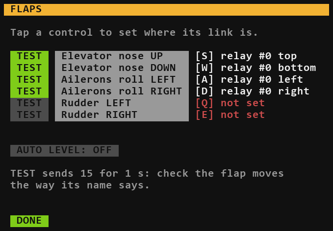

# Lava VTOL

ComputerCraft autopilot for a Sable ship that takes off vertically on downward
Create Propulsion thrusters and cruises on a rear thruster, flown through a
Rocket Pilot **Flight Controller (peripheral)**.

- **Lift thrusters** (nozzles down, e.g. a pair at each corner) hold the height and tilt the plane to move sideways or brake.
- **Rear thrusters** (nozzles out the back) push whenever the way to go is ahead of the nose.
- The nose can't be turned (vertical and rear thrust make no yaw), so targets off to the side are reached by sliding.
- Pushes cobble from Mechanical Generators into every basin and drains the basins into the lava tank, then feeds diesel to the Liquid Burner(s) picked with B (the one under the basin), lava to the other burners and to every thruster, fullest source first. Lands by itself when the lava runs low.

## Install

```
wget https://raw.githubusercontent.com/levisnakes/cc-lava-vtol/main/vtol.lua vtol.lua
```

Wiring: a wired modem on every thruster, on the Flight Controller and on this computer, all on the same cables, every modem right-clicked red. For refuelling, each thruster's modem must be on its intake end, and the onboard tank needs a modem too.

Run `vtol` (or `vtol log` to write `vtol.log`). Tap the buttons on screen (Advanced Computer) or use the keys.


Anything stopping a good flight shows in red under the panels, in plain words. Tap **BURNERS** to choose which Liquid Burner gets diesel:


| Key | |
|---|---|
| T | take off to `TAKEOFF_HEIGHT` |
| G | go to `x z` or `x y z` (`~` = relative) |
| H | hover here |
| L | land |
| M | manual (hovering): W/S forward speed, A/D sideways, R/F up/down 5, STOP button stops |
| B | pick which Liquid Burner(s) get diesel (saved) |
| SPACE / CTRL (hold) | **PLANE mode**: lift thrusters off, rear thrust at `SPACE_LEVEL` (10) / `CTRL_LEVEL` (15). Let go = rear off (glide). H = hover again. Works from a Linked Typewriter on the network (bind the keys to a frequency) or the keyboard |
| O | thrusters off |
| Q | quit (thrusters off) |

If the program stops for any reason the Flight Controller cuts every thruster after 1 s, so don't quit in the air.

## Flaps (PLANE mode)

The typewriter's keys go to this computer, and the computer drives the flaps through **Redstone Links** on **Redstone Relays** (or its own sides), so auto-level can add its corrections to yours. A typewriter and the computer sending on the same frequency would fight, so the flap links are powered by the computer only.

- Elevator **S** nose up / **W** nose down, ailerons **A** / **D**, rudder **Q** / **E** (bind each key to any spare frequency on the typewriter so it sends it).
- Each direction is one channel: a Redstone Link transmitter on a relay side, paired with a receiver on that side of an **Analog Compact Flap Bearing** (signal strength = how far it turns).
- Tap **FLAPS** (while hovering or parked) to set where each link is and **TEST** it. Turn **AUTO LEVEL** on there or in PLANE mode: it holds the wings level and the nose at `PITCH_TRIM`; a held key always wins on its axis.


